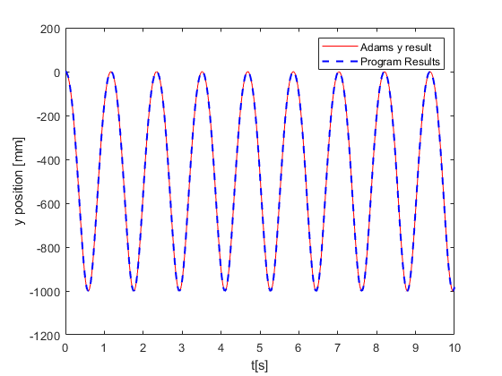
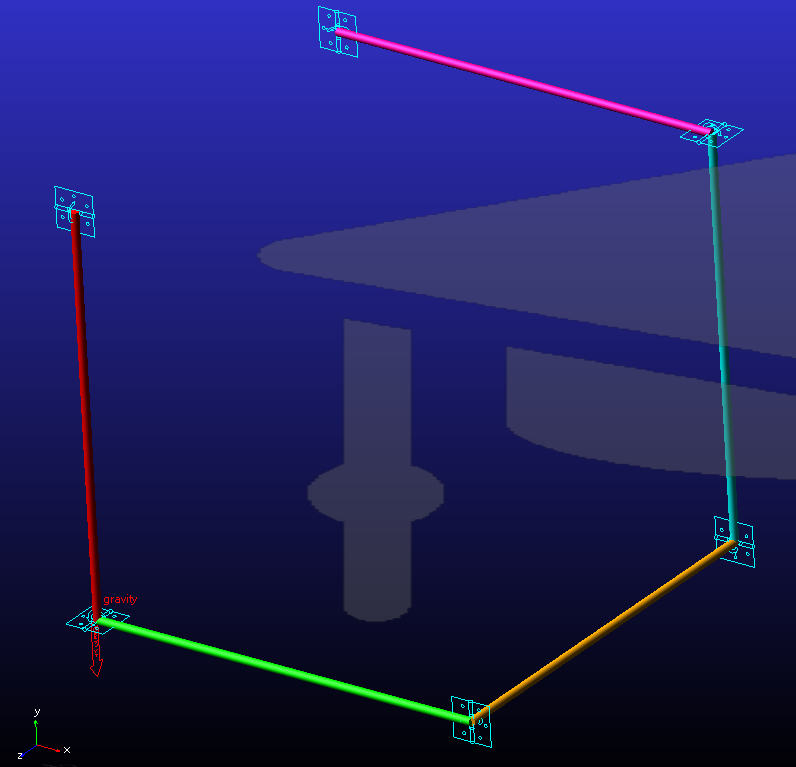
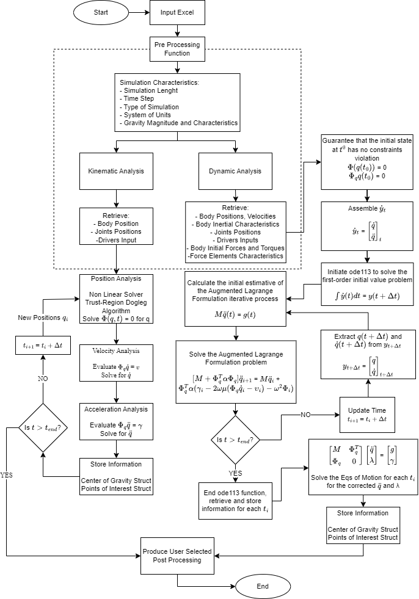

# 3D Multibody Dynamics Simulator (MATLAB)

A general-purpose 3D kinematics and forward-dynamics solver for rigid multibody systems, written from scratch for my MSc thesis at Instituto Superior Técnico so that the **FST Lisboa** Formula Student team could bring multibody dynamics into suspension design.

Models are defined in Excel (bodies, joints, drivers, force elements); the solver returns positions, velocities, accelerations and reaction forces, with 2D plots and a 3D animation of the motion.

<p align="center">
  
  
</p>
<p align="center"><sub>Left: simple pendulum, this solver (dashed) on top of MSC Adams (solid). Right: Bricard's over-constrained mechanism, reference model in MSC Adams.</sub></p>

## Results

Verified against **MSC Adams** on the five standard benchmark problems of González et al. (2006), each built as an identical model in both tools:

| ID | Problem | What it stresses | Difference vs MSC Adams (y displacement) |
|---|---|---|---|
| A01 | Simple pendulum | 2D reference case | 0.59 % |
| A02 | N-four-bar mechanism | Singular positions | 0.12 % |
| A03 | Andrew's mechanism | Very small time scale | 0.07 % |
| A04 | Bricard's mechanism | Redundant constraints (3D) | 0.05 % |
| A05 | Flyball governor | Stiff system (3D) | 1.88 % |

All five problems solved, every result within the 5 % acceptance margin (mean 0.54 %). Full convergence studies of the solver penalty parameters (α, Ω, µ) versus accuracy and run time are in the [thesis](docs/Thesis.pdf), Chapter 4.

## How it works

- **Orientation:** Euler parameters (quaternions) instead of Bryant angles, so the formulation stays free of rotational singularities.
- **Kinematics:** appended driving constraints; the nonlinear position problem is solved with a **trust-region dogleg** algorithm (faster than Levenberg–Marquardt on the same models), followed by the linear velocity and acceleration problems.
- **Dynamics:** index-1 **Augmented Lagrangian Formulation** for constraint stabilisation, integrated with the variable-step, variable-order **Adams–Bashforth–Moulton** predictor-corrector (MATLAB `ode113`), which ran 2–3× faster than `ode45` on the benchmark models. Initial conditions are made consistent with an inertia-weighted correction before integration.
- **Library:** spherical, revolute, cylindrical, translational, universal and composite joints; linear and nonlinear springs, dampers and actuators; sinusoidal and polynomial drivers; SI and mm-kg-s units.

<details>
<summary>Program flow</summary>

<p align="center"></p>
</details>

## Repository layout

```
solver/                 Full program: kinematics + forward dynamics (mbs-EP v1.0.6)
  mbssoftware.m         Entry point
  Excel Files/          Example and benchmark models
  Results/              Saved benchmark results
kinematics-solver/      Standalone kinematic solver (pK-EP v1.0.3)
  perfectKinematics.m   Entry point
docs/                   Thesis, extended abstract and figures
CHANGELOG.md            Development history, version by version
```

## Running it

Requires MATLAB with the Optimization Toolbox (`fsolve`).

1. Open `solver/mbssoftware.m`.
2. Set `filename` to one of the models in `solver/Excel Files/` (e.g. `'simple_pendulum_adams'`, `'bricards_mechanism'`).
3. Run the script. The simulation type (kinematic or dynamic), time step and run time are read from the Excel file.

For kinematics only, the standalone solver in `kinematics-solver/` runs the same way from `perfectKinematics.m`.

## Limitations

- Run time is 7–60× longer than MSC Adams on the benchmarks, mainly because MATLAB is interpreted while the Adams solver runs in compiled Fortran/C++.
- Penalty parameters for the Augmented Lagrangian are chosen empirically per model; the thesis includes a convergence library to guide the choice.
- No tyre model or unconditionally stable integrator (e.g. HHT) yet; these are listed as future work in the thesis.

## Documentation

- [Full thesis (PDF)](docs/Thesis.pdf): *Multibody 3D Simulation Tool for Vehicle Development*, Instituto Superior Técnico, 2022
- [Extended abstract (PDF)](docs/Thesis_Abstract.pdf)

## Third-party code

`solver/Dynamic Analysis/Regtools/` contains Regularization Tools by Per Christian Hansen, distributed under its own licence (see `license.txt` in that folder).

## Author

**Tiago Carvalho** · [LinkedIn](https://www.linkedin.com/in/tiagomspcarvalho/)
